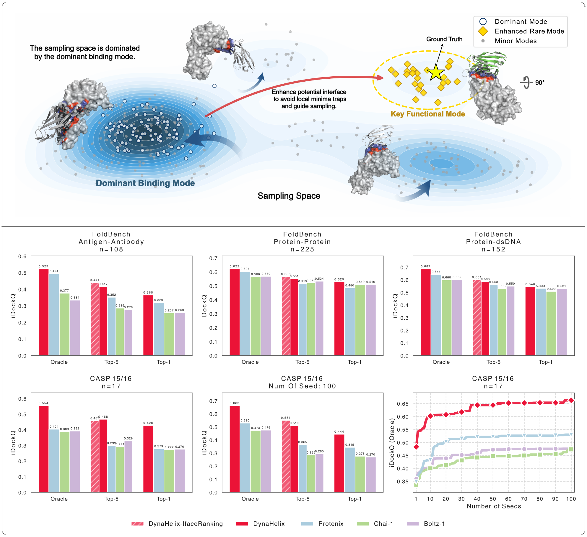

# DynaHelix: Unlocking diverse molecular binding modes using latent feature sampling



Accurately identifying key intermolecular binding sites is a critical and persistent challenge, as it is a prerequisite for generating high-precision structures with modern prediction models. To address this, we introduce DynaHelix, a deep learning system that identifies these critical binding sites within a comparable computational timeframe. DynaHelix leverages intermediate pair-wise features through a novel sampling strategy, which gathers critical binding patches to generate diverse interfaces for both the receptor and the binder, thereby avoiding local minima traps. Furthermore, DynaHelix provides mechanistic insights that guide structural modeling to focus sampling on the most critical binding sites when computational resources are limited. By amortizing the cost of generation against the requirement for accuracy, DynaHelix demonstrates a novel pathway to generating binding modes by capitalizing on the hidden features inherent in modern structure prediction models.

## Installation

From the repository root, run the one-step installer (CUDA 12.6 by default):

```shell
bash install.sh
```

For a CPU-only environment, run:

```shell
bash install.sh --cpu
```

After installation, activate the environment:

```shell
conda activate dyna
```

## Reproduction & Inference Guide
### 1. Reproduce Experimental Results
Follow the steps below to prepare the data, run the benchmarks, and analyze the metrics.

**Step 1: Prepare Data.** Download `benchmark.zip` and `ckpt.zip` from [DynaHelix Data](https://doi.org/10.5281/zenodo.18617574) and extract them into your current project directory.


**Step 2: Run Benchmark.** Download the model weights and execute the benchmark script:

```shell
# Execute benchmark script
sh benchmark.sh
```

**Step 3: Statistical Analysis.** **You can skip the first two steps to directly visualize our pre-processed evaluation data following the instructions below.** To visualize your own data using our scripts, please ensure it matches the provided format.
1. Download `summary.zip` from [DynaHelix Data](https://doi.org/10.5281/zenodo.18617574).
2. Extract the contents to the current project directory.
3. Run the following Jupyter notebooks:
    - `./summary/01_summary.ipynb`
    - `./summary/02_casp.ipynb`
    - `./summary/03_sentitive.ipynb`
    > **Note:** Predicted models for the CASP dataset are also available in `casp1516.tar.gz` at the link above.

#### 2. Inference with Protenix

Experiments are defined in `configs/exp_base_configs.yaml`. For example:

```yaml
"8ekz":
  input_json_f: ./example/8ekz.json
  seeds: [101]
  binding_type: protein-dna
  iface_version: auto
```

Each experiment supports the following fields:

| Field | Required | Description |
| --- | --- | --- |
| `input_json_f` | Yes | Path to the Protenix input JSON file, relative to the repository root or absolute. |
| `seeds` | Yes* | A non-empty list of integer seeds, for example `[101, 102]`. |
| `binding_type` | Yes | One of `abag`, `protein-protein`, or `protein-dna`. |
| `iface_version` | Yes | `auto` for automatic binder/target detection or `manual` for labels supplied by the input JSON. |

The checkpoint is selected automatically from `binding_type`:

- `protein-dna` uses `dyna_55199`.
- `abag` and `protein-protein` use `base_constraint`.

If `iface_version` is `manual`, define `isbinder` and `istarget` in the input JSON. At least one sequence must be marked as the binder and at least one as the target. A sequence must not be marked as both.

##### Run the complete pipeline

From the repository root, run:

```shell
python run_inference.py --exp 8ekz
```

##### Pipeline stages

- **`all`** runs the complete workflow. It first checks whether all iface input files already exist. If they do, the `msa`, `save`, and `input` stages are skipped and execution starts at `iface`. Otherwise, the stages run in dependency order: `msa` → `save` → `input` → `iface`.
- **`msa`** validates the `msa.precomputed_msa_dir` of every protein chain. Each directory must contain non-empty `pairing.a3m` and `non_pairing.a3m` files. Missing MSAs are searched with MMseqs2, saved under `<input JSON directory>/msa` by default, and written directly back into the original input JSON.
- **`save`** runs the configured Protenix checkpoint on the original input and saves hidden representations, including `s`, `s_inputs`, `z`, contact probabilities, and contact logits. Files are written as `outputs/<checkpoint>/sz/<sample>-<seed>.pt`. This stage requires valid MSA data.
- **`input`** reads the PT files produced by `save`, identifies candidate binding interfaces, and creates constraint-enabled inference JSON files beside the original input JSON. Each file is named `<experiment>_<checkpoint>_<seed>.json`. This stage requires every expected PT file.
- **`iface`** performs structure prediction from the constraint-enabled JSON generated by `input`. Results are written below `outputs/<checkpoint>/<experiment>/pred`. This stage requires every expected iface input JSON.

When a stage is run individually, its prerequisites are validated before the subprocess starts. Missing or invalid artifacts stop execution with an error listing the required files and the stage that must be run first.

##### Command-line options

```shell
python run_inference.py \
  --exp 8ekz \
  --stage all \
  --config ./configs/exp_base_configs.yaml \
  --msa-out-dir ./example/msa
```

- `--exp`: experiment name in the YAML file; defaults to `8ekz`.
- `--stage`: one of `all`, `msa`, `save`, `input`, or `iface`; defaults to `all`.
- `--config`: experiment YAML path; defaults to `configs/exp_base_configs.yaml`.
- `--msa-out-dir`: MSA output directory; defaults to `<input JSON directory>/msa`.

For example, run only the `input` stage:

```shell
python run_inference.py --exp 8ekz --stage input
```

The pipeline stops immediately if any stage fails, and later stages are not executed. Run `python run_inference.py --help` for the command-line reference.

### 3. Inference with Chai-1
We provide a script to convert Protenix constraints into Chai-1 compatible format. To perform inference with Chai-1, you first need to build the constraint inputs of Protenix using the Protenix inference pipeline, then convert them into inputs acceptable to Chai-1 using the provided script. Example code:
```shell
python protenix2chai.py --chai_downloads_dir=/mnt/tmp/chai
```
To use Chai-1 for inference correctly, you need to first install the relevant environment and properly set `-chai_downloads_dir=YOUR_CHAI_DOWNLOADS_DIR` in `protenix2chai.py`. For detailed instructions, refer to [chai-lab](https://github.com/chaidiscovery/chai-lab).

We do not currently provide a script to obtain potential interfaces directly from Chai-1's hidden embeddings.

# Cite